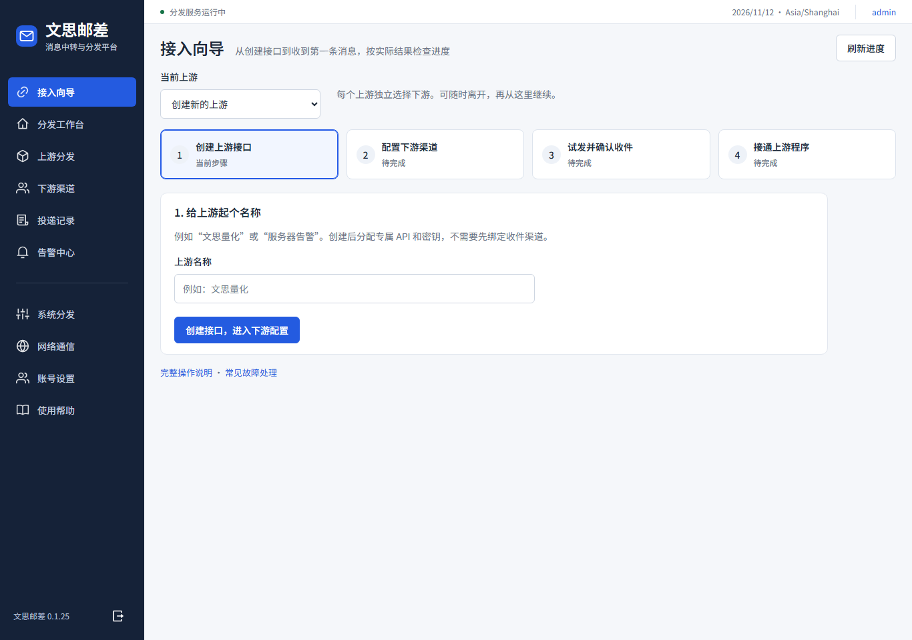

# 文思邮差

**消息中转与分发平台：上游接入一次，按各自配置发送到 QQ、微信、邮箱等渠道。**

> **第一版 v0.1.25：目前已适配 QQ 机器人、微信 ClawBot、QQ 邮箱，并完成真实收件验证。更多渠道接入正在适配与验证中。**

文思邮差是面向个人和小团队的 Python 通知中转服务。通过 Web 管理上游接口、收件渠道、预约发送与投递记录，使用 SQLite 持久化队列，不需要 Node.js、Redis 或外部数据库。

当前程序版本 **0.1.25**，处于早期试用阶段。Python 包与命令仍叫 `posthub`，已有 API 地址、`ph_` 密钥和数据目录继续使用。项目许可状态见 [许可说明](#许可说明)。

[快速上手](docs/guide/01-quickstart.md) · [完整操作手册](docs/README.md) · [第一版发布说明](docs/releases/v0.1.25.md) · [更新日志](CHANGELOG.md) · [测试范围](docs/TESTING.md) · [问题反馈](SUPPORT.md)



## 能做什么

- **独立上游接口**：创建接口即分配密钥；各上游分别勾选自己的下游，修改一个不会改变其他上游的授权。
- **多渠道分发**：同一消息可发送到多个 QQ、微信或邮箱收件目标，每个目标独立验证和记录结果。
- **接入向导**：创建上游 → 配置下游 → 平台试发并确认 → 接通上游程序。进度来自实际记录，平台试发不计入真实上游推送。
- **预约与自动补发**：未设置时间时保存后尽快发送；安全连接失败与限流持续重试至投递截止，已经成功的渠道不会自动重发。
- **可解释的故障状态**：显示下次重试时间，提供通信检测、授权检查和收件核实指引。微信等待新会话时给出相应操作。
- **Web 操作手册**：可搜索、下载并复制 API 示例；文档与程序一起提供。

上游使用独立下游配置，不再使用共享分发方案。“系统分发”中的方案仅供管理员手动发送时复用。

## 渠道与验证范围

当前已适配的主要收件渠道为 **QQ 机器人、微信 ClawBot、QQ 邮箱**。其他渠道保留扩展入口并逐步适配，具体进度如下；界面存在入口不代表已经完成对应真实账号验收。

| 渠道 | 接入方式 | 当前验证范围 |
| --- | --- | --- |
| QQ 机器人 | 官方机器人 AppID / AppSecret、会话选择、6 位收件验证码 | 已适配，真实收发已验证；个人/群能力仍受账号权限与额度限制 |
| 微信 ClawBot | iLink / ClawBot 本人扫码、会话同步、收件验证码 | 已适配，真实收发及新会话恢复已验证 |
| QQ 邮箱 | 自动填写 SMTP 参数，输入 SMTP 授权码 | 真实验证邮件与通知已验证 |
| Gmail / 通用 SMTP | 应用专用密码或服务器参数 | 参数、协议与本机 SMTP 测试；尚无对应真实账号收件验收 |
| Outlook / Hotmail | MSAL 设备授权 + Microsoft Graph；需自己的客户端 ID | 授权和发送流程模拟测试；真实微软账号验收待完成 |
| 企业微信 / 飞书 | 官方群机器人 Webhook，飞书可配置签名 | 适配器及回执测试；真实账号验收待完成 |
| 钉钉 | 应用机器人、成员或群标识 | 适配器及回执测试；真实账号验收待完成 |
| 自定义 HTTP | 接收端返回 2xx 和 `{"accepted": true}` | 真实本机 HTTP 收发与去重验证 |
| Apprise 扩展 | 一个 Apprise 通知 URL | 适配器测试；实际支持能力与回执取决于具体服务 |

邮箱 SMTP 使用 Python 标准库，Outlook 使用 Microsoft Graph；Apprise 用于扩展渠道。不同收件目标分别建立渠道并验证，再授权给上游。详见 [渠道配置](docs/guide/03-channels.md)。

## 安装并打开

普通用户可使用单独的正式安装包：解压后按包内 `INSTALL.md` 操作。它只包含一份完整程序、运行依赖清单和安装/升级脚本；升级前自动保存配套数据备份。详细步骤见 [正式安装包与升级](docs/INSTALLER.md)。下列命令适用于源码包。

需要 **Python 3.11+**。Windows 11 / Python 3.11 已实测；正式包的 **Debian 12 / Python 3.11、Ubuntu 24.04 / Python 3.12** 安装与升级已在独立 Linux 虚拟机通过，见 [Linux 验收](docs/LINUX-REVIEW.md)。Docker、其他版本与 GitHub 远端 CI 的状态见 [测试范围](docs/TESTING.md)。

获取源码或解压源码包后，进入包含 `pyproject.toml` 的 `posthub` 目录。正式安装包请使用其自带的 `install.sh` / `install.ps1`。

### Windows 11

在项目目录打开 PowerShell，确认 Python 已加入 PATH：

```powershell
python --version
powershell -ExecutionPolicy Bypass -File .\deploy\install.ps1
powershell -ExecutionPolicy Bypass -File .\deploy\start.ps1
```

执行策略参数仅作用于该次脚本进程，不修改系统策略。组织策略禁止脚本时，使用 [手动安装](docs/DEPLOYMENT.md)。

### Debian / Ubuntu

在已提供 Python 3.11+ 的系统中安装环境，再从项目目录运行：

```bash
sudo apt update
sudo apt install -y python3 python3-venv python3-pip
python3 --version
bash deploy/install.sh
bash deploy/start.sh
```

系统 Python 低于 3.11 时，先另外安装符合版本的解释器，再通过 `PYTHON_BIN=/path/to/python3.11 bash deploy/install.sh` 指定；不要替换系统 Python。详见 [部署说明](docs/DEPLOYMENT.md)。

### 首次登录

打开 **http://127.0.0.1:8787**，账号为 `admin`，使用安装终端显示的独立初始密码。首次登录先修改密码，再进入接入向导。已有安装保持原密码。

1. **创建上游接口**：只填名称即可，下游可稍后配置。
2. **配置下游**：添加渠道并完成收件验证，返回该上游配置后保存。
3. **试发与确认**：核对各渠道实际收到的测试消息，再登记收件。
4. **接通上游**：将平台生成的 API 地址与 JSON 格式填入上游程序，由上游提交一条测试消息。

## 上游推送示例

从页面复制专属 API 地址（已经包含密钥），使用 `POST`，内容类型 `application/json`，无需另填 Authorization。下面是请求正文：

```json
{
  "title": "服务器通知",
  "body": "这是一条接入测试消息。",
  "request_id": "server-event-001"
}
```

新业务事件使用新编号；同一事件超时重试保持编号和内容相同。标准 `POST /api/v1/messages` 也支持 `Authorization: Bearer 实际密钥`。查询结果、预约时间和权限说明见 [上游 API](docs/guide/02-upstream.md)。

**HTTP 202 表示已保存，不代表收件人已收到。** 尚未配置下游的消息保存为“待配置分发”；配置完成后需要确认旧消息仍有用，再单条放行。

## 可靠性与使用边界

| 状态 | 含义 / 下一步 |
| --- | --- |
| 等待重试 | 首次通常等待 30 秒，后续每 60 秒尝试；至成功或投递截止，实际开始受队列和网络耗时影响 |
| 等待微信会话 | 用绑定的微信向机器人发一句话；收到新会话后自动续发未过期任务 |
| 渠道已接受 | 渠道接口有成功回执，尚不等于实际收到或已读 |
| 收件人已确认 | 收件人主动确认，或管理员根据明确收件反馈登记 |
| 结果待核实 | 可能已经收到，先核实；不自动重发 |
| 已过期 / 已取消 | 不再继续发送 |

相同业务编号用于防止重复创建，成功渠道不会因其他渠道失败而自动重发。但第三方可能缺乏幂等或终端回执，本平台不承诺端到端“恰好一次”或必达。详见 [投递规则](docs/guide/04-delivery.md)。

- 单机、单管理员、单服务进程；SQLite 数据目录不应被多个服务共享。当前不支持多租户或多实例扩容。
- QQ/微信等发送能力依赖渠道账号与平台权限；渠道接入成功不等于无限制主动推送。
- 页面按当前浏览器时区显示；API 时间必须包含时区，消息默认投递截止为计划发送后 24 小时。
- 上游接入密钥无自动到期时间；可停用、重置或删除，与消息截止时间无关。

## 网络与长期运行

默认仅监听本机。局域网访问需要监听对应网卡，并放行实际端口；公网建议通过 HTTPS 反向代理访问。

“网络通信”分为通信检测、平台访问地址、连接方式。代理是可选项；中转台不创建 VPN 隧道。QQ、微信等 HTTP 渠道可指定 HTTP(S) / SOCKS5(h) 代理；邮箱与 Apprise 使用系统网络，可能经过 VPN / TUN。访问平台的网址不决定发往下游的接口地址。

固定地址、frp、Nginx、systemd、Windows 常驻及 Docker 说明见 [部署说明](docs/DEPLOYMENT.md) 和 [网络通信](docs/guide/05-network.md)。

升级前配套备份数据库与 `config.json`，后者包含解密密钥。不要重新初始化旧数据目录；原密码、密钥和渠道保留。操作见 [备份与升级](docs/DEPLOYMENT.md#备份恢复与升级)。

## 维护与参与

- [贡献指南](CONTRIBUTING.md)：开发环境、测试和提交要求。
- [问题反馈](SUPPORT.md)：故障报告、功能建议与需要提供的信息。
- [安全政策](SECURITY.md)：敏感问题使用私密报告渠道。
- [行为准则](CODE_OF_CONDUCT.md)：交流规则与处理方式。
- [发布流程](docs/RELEASING.md)：本地检查、GitHub Actions 和发布包检查。

## 许可说明

主项目采用 [MIT License](LICENSE)，允许使用、修改、商用及再分发，需保留版权与许可声明。软件按许可原文以现状提供。

第三方组件各自遵循其许可证；字体与图标的原许可文件已经随程序保存，见 [第三方来源与许可](THIRD_PARTY_NOTICES.md)。
